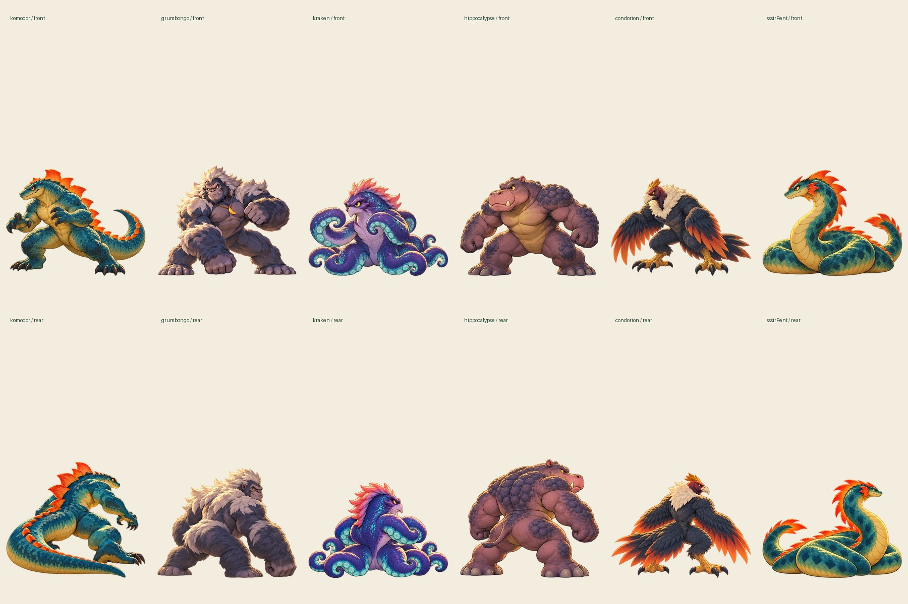

# World Kaiju Tournament

A complete, single-player illustrated kaiju tournament for desktop and mobile browsers. **v1.0 release candidate**: choose one of six original contenders, explore a sunlit coastal festival, and challenge the other five in any order. Play in English or Traditional Chinese.



## Run

Requires Node 24 and npm. From this repository:

```sh
npm ci
npm run dev
```

Open the printed URL, normally **http://localhost:5173**. For a production build:

```sh
npm run build
npm run preview
```

Open **http://localhost:4173**. No backend, accounts, WebGL, runtime image-generation service, or external game assets are required.

[Static hosting / GitHub Pages instructions](docs/release/DEPLOYMENT.md) · [Release review and limitations](docs/release/REVIEW.md) · [Implementation checklist](docs/release/CHECKLIST.md)

## Play

1. Choose a character card and enter the tournament.
2. Move with **WASD / arrow keys**, tap the plaza, or hold the direction buttons. The rival buttons walk your kaiju to a chosen opponent. Approach, then confirm the challenge.
3. Choose **Attack [A]** or **Defend [D]**. Mash **Space** or the large touch button for **three seconds**. Each discrete press adds 1% to the relevant attribute; holding a key does not count.
4. Defend deals no damage, but reduces incoming damage and, if you survive, makes your next Attack mandatory and **×1.5** stronger. The opponent always attacks. Both HP changes resolve together, even on a double knockout.
5. Face all five rivals once. HP resets each match. Losses and draws never stop the tournament; draws count as losses. Five wins earns Champion, four earns second, down to zero wins in sixth. Start another tournament from the results screen.

Use **EN / 繁中** at any time. Language, mute preference, and finished matches save locally when storage is available. Reloading an unfinished battle returns to the grounds without consuming that opponent. There is no cloud save. The sound button controls locally synthesized music and effects; audio starts after a user gesture.

## Verify

```sh
npm test
npm run test:balance
npm run test:browser
npm run build
```

Browser tests require Chromium; see [deployment/testing instructions](docs/release/DEPLOYMENT.md). Artwork rebuilds use the existing Python/Pillow/NumPy/SciPy tools; [source assets and export workflow](assets/README.md) are included. Rebuilding artwork is **not** necessary to play or build the game.

## Implementation

The working combat POC was extended, not discarded. `src/combat.js` retains the simultaneous damage arithmetic, integer half-up rounding, three-second input and Guard & Counter tests. `src/roster.js`, `tournament.js`, `i18n.js`, `input.js`, `assets.js`, and the two presentation modules separate data, progression, localization, input, loading, and visuals.

Canvas 2D composites optimized transparent illustrated poses against a painted arena. Every contender has a rear three-quarter player view and front opponent view. A shared presentation stages preparation, strike, guard, reaction, recovery and defeat with root movement, contact accents, restrained shake and Web Audio feedback. These are limited pose animations, not continuous rigs. The explorable grounds use the same art identity and perspective-scaled sprites over an original environment painting.

The sole balance adjustment is **Hippocalypse ATK 85 → 110**. Other stats and mechanics are unchanged. [Deterministic simulations and rationale](docs/release/BALANCE.md) cover all 30 ordered matchups at four input rates. At 30 presses per round every matchup has a winning legal strategy. Lower rates remain harder; this has not been validated with child playtesters.

Physical phones and Safari have not been tested. Character details can drift between poses; transitions are visibly stepped. See the release review for actual browser measurements, remaining limitations and verification coverage. No console-generation equivalence is claimed.

## Project record

The [production brief](docs/release/PRODUCTION-BRIEF.md) approves the illustrated pose-based workflow and complete v1.0. It supersedes previous art holds and approval gates.

- [Current GDD v1.1](docs/GDD-v1.1.md); [original historical GDD](docs/GDD-v1.0.md)
- [Visual direction studies](docs/visual-direction/README.md), including approved sample 03
- [Accepted animation trial](experiments/animation-trial/README.md) and [historical assessment](docs/animation-trial/REPORT.md)
- Original rejected procedural 3D POC remains in Git history and unused legacy source. It is not the release renderer and does not ship in the application bundle.

Project code/art remain **UNLICENSED**. [Third-party software licenses](docs/release/DEPENDENCIES.md) do not grant a license to project-generated artwork.
