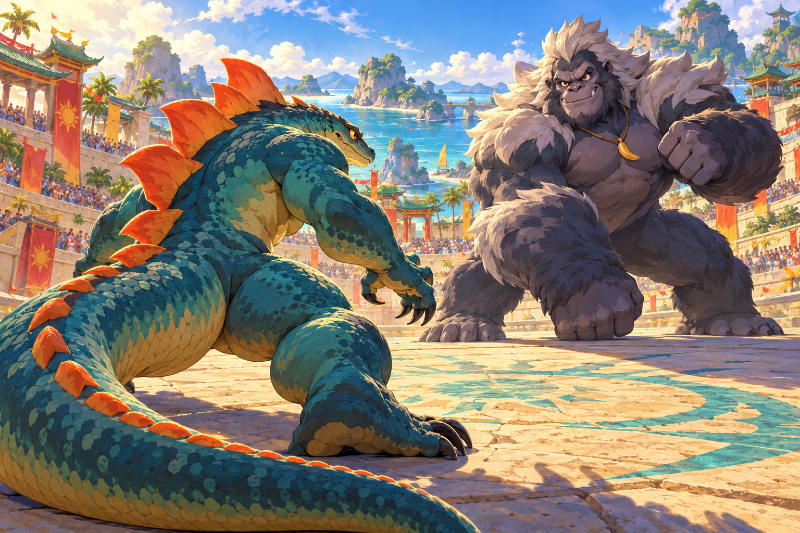
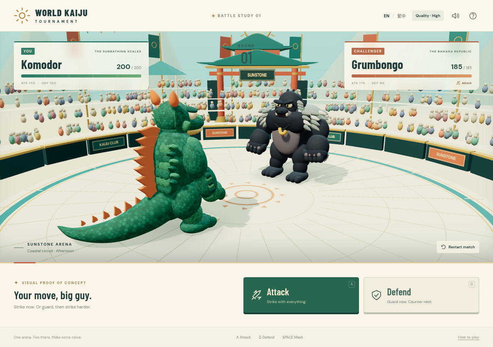

# World Kaiju Tournament

**Current status: animation feasibility trial delivered for review.** Sample 03 was approved as the visual target for this bounded experiment. The result demonstrates reusable illustrated frame assets and real playback, but **does not establish a production-ready autonomous animation pipeline**. The initial procedural 3D POC remains unapproved artistically.

- [Animation assessment and production report](docs/animation-trial/REPORT.md)
- [Download the actual ten-second MP4 — effects off](experiments/animation-trial/output/motion-study.mp4?raw=true)
- [Reusable source drawings, timeline, and export scripts](experiments/animation-trial/)
- [Download the lightweight reviewer ZIP](experiments/animation-trial/output/animation-review.zip?raw=true)


*The preview and MP4 are exported from the saved PNG drawings and timeline, not a separately generated video. The report distinguishes reusable playback from unresolved anatomy consistency and motion quality. No new complete battle or full game has been built.*

## Approved visual target and earlier comparison

- [New visual samples and review gallery](docs/visual-direction/README.md)
- [Four production pipelines and recommendation](docs/visual-direction/PIPELINE-COMPARISON.md)
- [Current GDD v1.1 — rendering technology is optional](docs/GDD-v1.1.md)
- [Proposed next POC and acceptance gates — not started](docs/visual-direction/NEXT-POC.md)



*Sample 03: approved as the trial's static visual benchmark. Its image remains unchanged. This approval does not extend to the trial result, a production pipeline, another playable battle, or the full game.*

## Initial POC — historical engineering reference

The playable 3D **Komodor versus Grumbongo** experiment below is retained for its combat rules, interaction, localization, and tests. Its initial [GDD v1.0](docs/GDD-v1.0.md) and [historical review](docs/POC-REVIEW.md) remain available. Commit [`bd13bd8`](https://github.com/jaychtw/kaiju-tournament/commit/bd13bd887888921f1d6fcd646ae82b204b3df628) preserves the exact original build. The run instructions below refer to that retained technical experiment, not to the new visual targets.



## Run

Use Node.js **22.12+ or 24 LTS** and npm. Development was validated with Node 24.19.0 and npm 11.9.0.

```sh
git clone https://github.com/jaychtw/kaiju-tournament.git
cd kaiju-tournament
npm ci
npm run dev
```

If the repository is already cloned, start from `cd kaiju-tournament`. In the restricted cloud workspace, use `npm ci --cache /tmp/wkt-npm-cache` for a writable npm cache.

Open the address printed by Vite in a browser. In a hosted workspace, use its port-forwarding facility for port **5173**. On a phone on the same accessible network, use the development machine's network address; loopback on a phone refers to the phone itself.

For a production build:

```sh
npm run build
npm run preview -- --port 4173
```

`dist/` is a standalone static site. There is no backend, account, API key, external asset fetch, or database. WebGL 2 and a recent browser with hardware acceleration are required. Audio begins after interaction; the sound button mutes music and effects together.

## Play and review

1. Choose **Attack** with **A**, or **Defend** with **D**. Both actions also have large touch buttons.
2. Repeatedly press **Space** or tap the orange button for **three seconds**. Holding a key does not add presses. Each press adds 1% to that action's effective attribute.
3. Both combatants resolve their effects together. Grumbongo always attacks.
4. Defend deals no damage, increases defense for that round, and charges your next Attack by **×1.5** if you survive. Defend is unavailable until you use that charged Attack.
5. Use **EN / 繁中** at any point without resetting the match. Language and mute preferences persist locally. Use the restart icon or **Play again** to reset the match.

For a useful visual review, try a basic Attack, then restart and try Defend → Charged Attack. Watch the anticipation, lunge, shield absorption, recoil, damage numbers, tail, brows, blinking, camera response, and KO pose. Turn sound on. Review both **High** and **Eco** quality, and portrait and landscape phone sizes.

Komodor: **200 HP / 150 ATK / 100 DEF**. Grumbongo: **185 HP / 175 ATK / 90 DEF**. Final damage rounds to the nearest integer, with half values rounded upward. HP is clamped at zero. An outgoing attack still lands if its sender is knocked out; simultaneous KOs produce a draw. There is no mash cap beyond the real three-second input window.

With no mash presses, three basic Attacks lose. Defend → Charged Attack → Attack with no presses produces a double KO. A stronger Guard → Counter can win before the third round.

## Implementation and assets

- **Three.js / WebGL 2**, JavaScript modules, Vite. No game engine framework or speculative tournament systems.
- Two bespoke articulated character assemblies: sculpted rotational profiles, swept/tapered tail geometry, beveled dorsal plates, modeled facial details, overlapping fur locks, hands and claws. Geometry and procedural scale/fur textures are authored in `src/models.js` and generated locally. These are animated volumes, not portraits or sprite substitutions.
- Joint-group animation controls the torso, head, jaw, shoulders, elbows, legs, brows, eyes, and tail. Idle breathing, blinking, anticipation, attack, guard, counter, hit, victory, and knockout poses use the same character assemblies. A timed scene sequence provides lunge, recovery, camera push, restrained shake, swipe, shield, shockwave, flash, and pooled particles.
- A sunlit coastal festival arena shares the characters' teal, sandstone, coral, and gold palette. Tiered seating, an instanced crowd, curved gate roofs, palms, clouds, banners, stone seams, and a painted sun emblem supply perspective and atmosphere.
- Web Audio synthesizes percussion, a quiet melodic loop, taps, guard chimes, impacts, and result stings. There are no borrowed recordings.
- `src/combat.js` is a renderer-independent pure rules module. Animation order cannot change the combat calculation. `src/i18n.js` owns the English and Traditional Chinese text. `src/main.js` handles the UI and input.
- Fonts are bundled locally: **Barlow Condensed** and **DM Sans**, under the SIL Open Font License. Chinese uses the device's CJK font. Third-party licenses are in `docs/licenses/`.

This pipeline did not meet artistic acceptance. See [the new production reassessment](docs/visual-direction/PIPELINE-COMPARISON.md); the descriptions above explain the historical build, not the recommended future graphics.

## Validation

```sh
npm test                 # deterministic combat tests
npm run build           # production bundle
npm run test:browser     # actual Chromium rendering + keyboard/touch flows
```

The browser suite uses `/usr/bin/chromium` in this cloud environment and SwiftShader for software rendering. Set `CHROMIUM_PATH=/path/to/chromium` to use another system Chromium. Test screenshots are written to `test-results/`. The suite starts Vite automatically if port 5173 is free.

The tests exercise combat formulas, charge lifecycle, zero damage, rounding, double KO, immutable resolution, actual keyboard input and repeat rejection, single-count touch input, language persistence, HP updates, victory, defeat, rematch, and responsive layouts. They do not establish physical-phone frame rates or Safari compatibility.

The completed run passed **10 combat tests and 5 browser scenarios**, a clean dependency install, a production build, and a production-server Guard & Counter smoke check. The production smoke made no external asset requests and recorded no console/runtime errors or failed requests. [Validation details and captures](docs/evidence/VALIDATION.md).

For rendering measurements in your browser console:

```js
wktDiagnostics()
// phase, HP/charge/round snapshot, presses, FPS, draw calls, triangles, DPR, quality
```

High caps DPR at 1.7 and enables dynamic character shadows. Eco caps DPR at 1.15 and retains soft contact patches while disabling shadow maps. Narrow screens default to Eco. Background tabs pause the mash window and scene progression. Reduced-motion preferences disable camera movement and shorten UI transitions; essential character motion remains.

## Review boundary

Work is paused for review of the [animation feasibility trial](docs/animation-trial/REPORT.md), under [GDD v1.1, Section 12](docs/GDD-v1.1.md#12-visual-development-and-proof-of-concept-milestones). Do not implement another full playable battle, expand the roster/tournament, hire an artist, make purchases, or migrate the application renderer without the applicable authorization. The benchmark remains sample 03; the current animated result is not a production pass.
