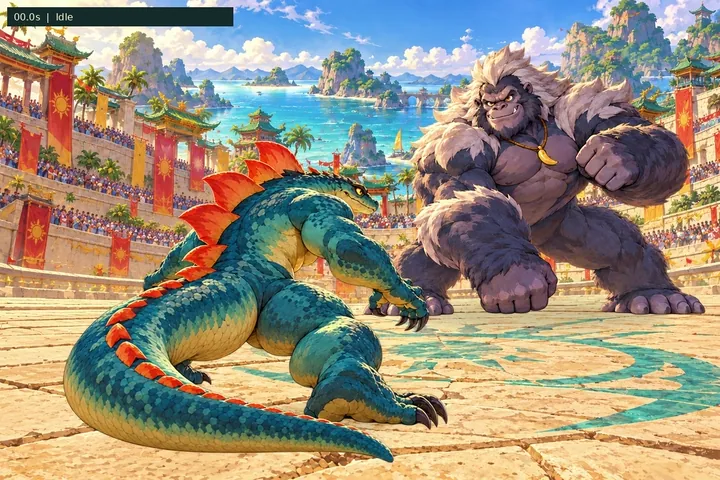
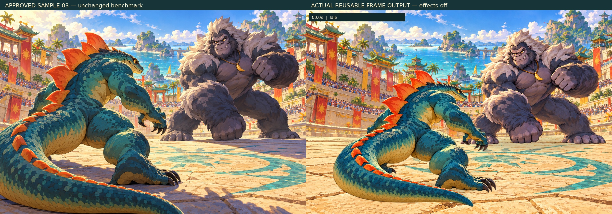

# Animation feasibility trial — assessment

> **Production update:** The user accepted the pose-based trial and approved the complete six-kaiju game. The former stop/gate recommendations below are historical and superseded by the [v1.0 production brief](../release/PRODUCTION-BRIEF.md) and [release review](../release/REVIEW.md). Continuous rigging is not required.

**Outcome: partial feasibility, not a production pass.** We can turn the approved illustration into attractive, reusable alpha pose drawings and reproduce a ten-second scene from them. This trial does **not** establish that an autonomous workflow can deliver sample 03's quality as consistent, convincing, production-ready animation. The remaining bottleneck is character/animation asset production, not whether a browser can display the images.

Sample 03 was approved as the target for this bounded experiment only. It remains [byte-identical](../../experiments/animation-trial/assets/benchmark.png). No complete battle, gameplay change, full roster, exploration, or engine migration was implemented.

## View the actual result

This is a 720×480 compressed animated preview of the **actual source-asset export**, not generated video. For fidelity review, download the [1200×800 primary MP4, effects off](../../experiments/animation-trial/output/motion-study.mp4?raw=true). It is silent, exactly 10.000 seconds, and opens in a standard video player/browser. GitHub may require clicking **Download** or **View raw** first. No development tools are required.

Also available:

- [Same output with restrained accents](../../experiments/animation-trial/output/motion-study-effects.mp4?raw=true)
- [Download the lightweight asset reviewer](../../experiments/animation-trial/output/animation-review.zip?raw=true): reusable PNG sprites, timing, review controls, and the primary MP4. Extract the ZIP before opening files. Local HTML launch is unverified because the cloud's managed browser blocks `file://`; if your browser also blocks local HTML, open the included MP4. HTTP viewer playback was tested.
- [Raw source drawings, timeline, and reproduction scripts](../../experiments/animation-trial/)
- [Six representative phases, effects off](../../experiments/animation-trial/output/phase-contact-sheet.jpg)
- [Light/dark alpha-edge comparison](../../experiments/animation-trial/output/alpha-matte-check.jpg)

## Target versus result

The comparison preserves the benchmark rather than repainting it to make the trial look closer. The result has the same graphic palette, broad rear Komodor, expressive front Grumbongo, scale/fur treatment, and coastal arena. The new composition is somewhat wider and the character/ground relationships differ. These images are not pixel-matched views of one model.

The character drawings retain much of the target's appeal: Komodor's guard really changes forearms, shoulders, neck, and crouch; the counter coils the torso; the strike changes arm extension, foreshortening, feet, and tail shape. Grumbongo changes from a grin to a wide-eyed, open-mouth reaction. Those are drawn anatomical changes, not a single portrait sliding or rotating. Nevertheless, redrawing the character does not preserve its detailed topology: scale patches, scutes, fur locks, charm placement, and some proportions change across drawings. Some apparent pose movement is unwanted drawing drift.

### Assessment against the requested dimensions

“Pass” means demonstrated at this trial's scope, not full-game approval. “Partial” means useful evidence with material gaps. “Fail” means a required production claim is not met. “Unverified” means no relevant evidence was obtained.

| Dimension | Status | Concrete evidence and gap |
| --- | --- | --- |
| Visual fidelity | **Partial** | Rich illustrated surfaces, faces, color, and lighting survive individual extracted frames; matte checks show usable silhouettes. The four-pose sheets provide roughly 500px-high drawings rather than the full-scene benchmark's character detail. Some pose redraws alter mass/design, and the wider composition changes scale. Video adds ordinary compression/chroma loss; PNG drawings remain inspectable. |
| Character identity | **Partial** | Both kaiju remain recognizable; the gross limb count and rear/front conventions hold in inspected poses. Fine markings, plate/fur shapes, proportions, and digit depiction are not constrained by one anatomical source. Exact digit/topology consistency is not certified. No semantic layered master or rig makes those details invariant. |
| Motion quality | **Partial; production gate not passed** | Anticipation, a braced guard, torso windup, an extended strike/contact, a facial reaction, and recovery are readable. Sparse pose changes still look stepped; the tail changes shape abruptly, poses pop, and recovery lacks fully authored in-betweens. One annotated support point per pose is not planted-foot animation or IK; the other foot and tail are not constrained. Constant actor-scale and explicit root-position steps stage the images but do not solve continuous weight transfer. |
| Artistic coherence | **Partial** | The background, characters, palette, and upper-left light direction belong together. Light/dark matte inspection is usable. Grounding uses approximate soft contact ellipses, not pose-accurate cast-shadow passes. Contact placement was tuned for this one view; depth, feet, and occlusion are not solved generally. |
| Asset reusability | **Partial** | 28 separate RGBA drawings, source sheets, pivots, and a timeline support replay, retiming, alternate exposure choices, and recombination. They are not a free-form character rig: a substantially new action/view still needs new drawings and review. Hidden surfaces and individual body parts were not separately produced. |
| Repeatability | **Partial locally; full roster unverified** | Component extraction/export works across all seven produced sheets; rebuilding preserves sprite hashes and deterministic source composition. Prompt-to-image generation is nondeterministic. This is one short sequence with one view per character, not proof of reliable additional clips, reversed battle roles, or all six anatomical families. |
| Autonomy | **Partial** | The entire recorded trial—reference-guided redraws, extraction, manual coordinate annotation, timing, viewer, video, and QA—was performed without a hired artist or new paid purchase. Professional in-between drawing, anatomical cleanup, and reliable contact remain unresolved. Technical autonomy did not automatically produce artistic acceptance. |
| Reusable-source/video correspondence | **Pass** | Both MP4s contain 300 encoded frames over 10 seconds. Decoded video samples match the actual PNG/timeline compositor within expected lossy encoding differences. No independent video-generation step exists. |
| Production-ready autonomous pipeline | **Fail / not established** | The current assets cannot promise invariant anatomy, fully convincing continuous action, or predictable effort for new actions/kaiju. Delivering files and a working player is insufficient to pass that requirement. |

The 30 FPS video contains **held/reused drawings**, not 300 newly drawn motion frames. There are 20 Komodor and 8 Grumbongo drawings. The reviewer exposes the frame IDs, timing, support-point guides, and alpha sprites, so the sparsity and registration are inspectable.

### With and without effects

The primary export has decorative effects **off**. The alternate adds only a thin counter-preparation ring and a few brief contact strokes. Both use identical body drawings, positions, timing, and reactions. Neither uses camera shake, flashes, sound, or particles to conceal the body. The clean version establishes that the guard/strike silhouettes read; the accented version does not repair stepped transitions, texture/shape popping, or the contact limitations. Inspecting the clean output in slow playback is the appropriate acceptance test.

## Production process and effort

### Selected workflow

Reference-conditioned **drawn pose animation** was the most promising bounded test with the available tools. It gives direct evidence of high-quality action art, keeps the graphic treatment, exposes all source frames, and avoids returning to the rejected procedural 3D assemblies. A cutout rig would first need clean semantic parts and painted hidden surfaces; neither existed. Generating video alone would fail the reusability requirement. Blender was available, but inventing a production sculpt/rig would introduce another unproved asset workflow rather than test the approved illustration directly.

1. Preserve sample 03 and record its hash. Generate isolated full-body rear Komodor and front Grumbongo masters, with real alpha, using only approved project references.
2. Generate seven four-pose sheets: Komodor idle, guard, counter, strike, recovery; Grumbongo attack and reaction. These are the actual saved RGB/alpha drawings, not reconstructed from a video. Request a matching empty arena plate for composition.
3. Inspect the alpha and layouts. A literal 2×2 grid crop **failed**: tails and toes crossed requested panel boundaries. Switch to connected foreground-component extraction, which recovers the four separate drawings from each sheet. Stop if the expected bodies are connected, missing, or clipped; the script does not invent missing pixels.
4. Preserve the raw sources. Remove neighboring-body contamination where bounding rectangles overlap; trim padding; remove alpha below 4; normalize the generator's maximum alpha of 254 to 255. These are disclosed alpha/cropping operations. **No RGB paintover, anatomical correction, optical flow, or hidden in-between generation was performed.**
5. Manually annotate 28 support-foot pivots in source-image coordinates, select exposure timing, and stage explicit actor positions. These are agent-made curation/registration choices, not an automatic character rig. No professional human drawing cleanup was supplied.
6. Export the 28 RGBA PNGs and manifests. Composite them on the empty arena with fixed per-character scale and a fixed camera. The browser and Python exporter use the same frame IDs, pivots, roots, phases, and draw order. There are no crossfades or animated whole-image rotations/scales. Root-position changes are explicitly recorded and remain a source of contact limitations.
7. Export the clean/accent MP4s and a smaller animated preview from the clean MP4. Build the reviewer and no-install media package. Compare source hashes, timing, representative decoded video frames, matte edges, and browser playback.

Full prompts, references, and request timestamps are in [PROMPTS.md](../../experiments/animation-trial/PROMPTS.md) and [generation-log.json](../../experiments/animation-trial/generation-log.json). Reproduction commands and tool/license details are in [the experiment README](../../experiments/animation-trial/README.md).

### Measured time versus unknown effort

| Stage | Recorded work / timing |
| --- | --- |
| Source-art generation | 10 successful tool requests: 2 masters, 7 sheets, 1 arena. Request intervals total about **27.0 minutes**, overlapping across batches; first request to last completion spans about **18.4 wall-clock minutes**. These are tool intervals, not human labor estimates. |
| Extraction/layout diagnosis | Initial eight-sprite extraction: **6.388 s**. Full 28-sprite build: **23.045 s**, measured by the script. Fixed-grid clipping was diagnosed and replaced with component extraction. |
| Registration, timing, engineering and visual review | 28 manual pivot annotations plus exposure/root staging, script/viewer authoring, and inspection. Active labor was **not separately timed**; it overlapped generation. No artist cleanup hours or professional animation-production rate were measured. |
| Video export | Clean **16.186 s**; accents **16.218 s**, run concurrently. These figures include loading/compositing/encoding in this environment. |
| Validation | Seven browser time selections, actual live playback, encoded-video playback, 390px layout, matte/accent/guide controls, hash/timing checks, and three video/source sample comparisons. Validation activity was not separately labor-timed. |

The saved logs distinguish request intervals and machine processing from unmeasured active effort. Do not multiply this one sequence's generation time by six to estimate roster production: artist cleanup, in-betweens, reverse views, and different anatomy are not included.

### Formats, storage and memory

| Item | Measured format / size |
| --- | --- |
| Raw drawings | 9 RGBA source PNGs, 1536×1024 each: 2 masters + 7 sheets, **20.47 MiB** stored. Arena is an additional RGB plate; generation count is 10. |
| Exported drawings | 28 variable-size trimmed RGBA PNGs; exact dimensions/pivots/hashes in `assets.json`. **14.13 MiB** stored, **34.09 MiB** decoded RGBA. |
| Viewer visual images | All sprites + arena + benchmark reference: **19.65 MiB** PNG download and **46.09 MiB** decoded RGBA calculation. This is not a measured browser-process memory profile. |
| Canvas buffer | 1200×800 RGBA: **3.66 MiB** for one backing buffer. Browser image copies, extra buffers, video decoding, and GPU uploads can add memory. |
| Primary MP4 | 1200×800, 30 FPS, 300 encoded frames, H.264 / YUV420p, silent, **3.40 MiB**, **10.000 s**. |
| Accented MP4 | Same timing/format, **3.41 MiB**. |
| Preview | 720×480 animated WebP from the real clean MP4, **1.29 MiB**. It is a reduced/compressed review aid, not the fidelity master. |

See [asset-metrics.json](../../experiments/animation-trial/output/asset-metrics.json). The reviewer preloads this entire experimental drawing set and the benchmark. Its image download exceeds the proposed 12 MiB future-POC budget; no streaming, new atlas system, or compression-quality certification was implemented to make that number pass. Calculated decoded image storage is below the provisional 128 MiB texture target, but peak process/GPU memory and physical-device behavior remain **unverified**.

## Failed/limited approaches and unresolved dependencies

- **Prompted grids are not reliable export geometry.** The component-based correction worked for these separated bodies; touching silhouettes or disjoint tentacles/feathers could require manual masking/grouping. It is not a universal one-click atlas exporter.
- **Frame consistency is not character topology.** The detailed drawings remain attractive but independently interpreted. Registration cannot fix changed body mass, markings, toes, plate/fur construction, or missing in-betweens.
- **Key poses are not finished action.** Anticipation/contact/reaction are present, but sparse transitions and tail/foot popping prevent a production-motion claim. Adding more prompts is not guaranteed to converge and was not pursued as an elaborate workaround.
- **Matte cleanup is limited.** Light/dark checks are usable for the exported examples, but no artist cleaned every fur/scale edge. The alpha normalization is documented; it does not reconstruct layered body parts or hidden surfaces.
- **Ground contact and shadows are approximate.** Pivots are hand annotations, not a ground-constrained rig. Soft ellipses supply contact grounding, not accurate moving cast shadows. A general camera/depth workflow is unproved.
- **Access limitation:** the managed cloud Chromium refused `file://` with `ERR_BLOCKED_BY_ADMINISTRATOR`; that policy was not bypassed. HTTP reviewer playback and MP4 decoding were verified. Direct ZIP/HTML launch on an unmanaged browser, Safari/iOS behavior, and physical devices remain unverified. The MP4 and inline animated preview provide the no-development-tools review path.
- **No new paid dependency was introduced.** No software/assets/credits/subscriptions were purchased and no artist was hired. Built-in image generation and installed open-source processing tools were used. No external animation/generative-video service, Blender rig, or human-cleaned layered master is claimed.

To make this particular direction dependable, the unresolved work is stable character source construction plus authored, anatomically consistent in-betweens and contact/tail timing. A specialist illustrator/animator could address that, but none has been commissioned or costed. An alternative autonomous rig/layer/model tool would need its own bounded test; merely changing the renderer does not supply the missing assets.

## Full-roster feasibility — assessment only

| Kaiju | Evidence from this trial | Additional anatomical requirement |
| --- | --- | --- |
| Komodor | **Partial**, 20 rear-view drawings. Tail opposition, guard and strike poses are visible; continuous tail length/scale pattern/contact are not guaranteed. | A stable tail/hip source with constrained arcs or carefully authored frame drawings; planted feet, foreshortened arm, and head-profile consistency. Front battle view not produced. |
| Grumbongo | **Partial**, 8 front-view drawings. Massive arm attack and surprised face read; mantle, charm and body details drift. | Reliable shoulder/forearm/hand articulation and face replacements/in-betweens; mantle motion/occlusion. Rear battle view not produced. |
| Kraken | **Unverified**; no assets created. | Persistent tentacle identities/lengths, many simultaneous arcs, self-occlusion, clean contacts. Likely needs tentacle-specific spline/rig and redraw work; separated-component extraction alone is insufficient. |
| Hippocalypse | **Unverified**; no assets created. | Heavy torso/hip mass, jaw deformation, subtle weight transfer and grounded steps. A biped workflow may transfer in principle, not the current drawings or proven effort rate. |
| Condorion | **Unverified**; no assets created. | Wing folding/extension, feather attachment/order, large changes in silhouette, foreshortening and landing. Needs a wing/feather-specific hierarchy or authored frame plan. |
| Sssir Pent | **Unverified**; no assets created. | Constant body length/markings through coils, overlapping depth order, and continuous contact. Likely a spline/mesh/body-segment approach with coil replacement art, not a two-legged pose-sheet workflow. |

The eventual roster needs front and rear conventions for all six kaiju. This trial supplies only two of those twelve actor/view combinations. It cannot establish six-character cost, turnaround consistency, or a common animation rig.

## Recommendation and stop decision

**Keep sample 03 as the artistic benchmark; do not approve the next full playable battle on this evidence alone.** Preserve the useful sources and deterministic exporter. Treat automatic pose generation as a promising drawing assistant, not a demonstrated substitute for stable character construction and animation craft.

The most credible route to dependable motion is a short source-asset/in-between cleanup test against the same target, using specialist help only if separately authorized. If continued autonomy is the priority, the next hypothesis should be **clean semantic layers and a small actual rig built from one master, with a separately authored contact pose**, rather than more unconstrained pose generations. Blender's free plane/armature tools are one available candidate; preparing consistent hidden surfaces/layers remains unproved and was not done here. That trial should first prove one short, stable guard-to-counter transition, not expand into a game or another batch of roster characters. These are future decisions for the user, not work started here. No purchase, hire, or migration is implied.

The experiment reduced uncertainty: image quality can survive into reusable frame assets, and those assets can drive real browser/video output. Continuous, anatomically consistent production animation remains the hard, unresolved part. **Stop here for review.**
