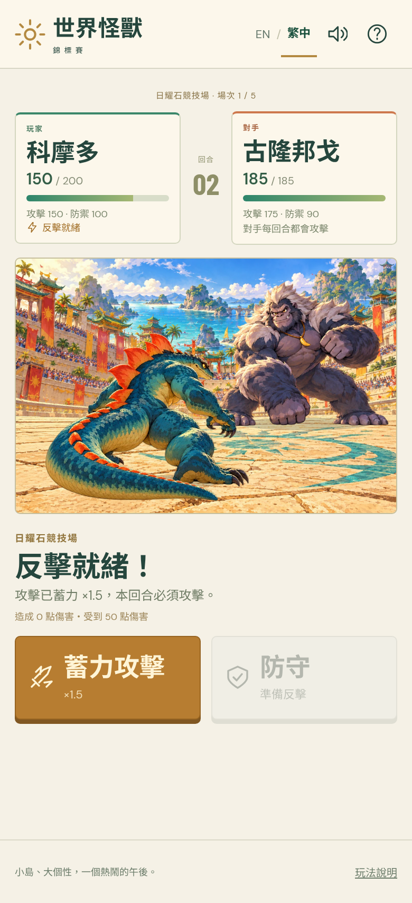

# v1.0 release candidate — review

The complete game is playable: **Select → Explore → Challenge → Battle → Repeat → Final Results → Play Again**. The accepted illustrated pose-based trial is the production foundation. No further art/rigging gate blocks this release candidate.

[Download the built game](../../release/world-kaiju-tournament-v1.0.0-rc.1.zip) · [Launch / GitHub Pages instructions](DEPLOYMENT.md) · [Source implementation checklist](CHECKLIST.md)

## Completed

- All six original kaiju, names/clans/personality/stats, selection cards, and clear selected state.
- A compact perspective venue with a central arena, five visible rivals, keyboard movement, touch direction controls and tap-to-walk. Rival buttons move the player's actual kaiju before opening the proximity confirmation. Declining does not consume the match; previously fought rivals remain marked and cannot be challenged twice.
- Character-specific rear player/front opponent illustrated poses and shared preparation, Attack, Defend, charged Attack, hit/recovery and knockout presentation. Simple contact shadows, impact accents, restrained camera shake, synthesized music/effects, and mute control.
- Original three-second discrete mashing, simultaneous damage, half-up rounding, mandatory nonstacking ×1.5 counter, double knockout, independent full-HP matches, and five-opponent scoring. No Dodge, additional AI mechanics, or NPC-versus-NPC simulation.
- Complete English/Traditional Chinese interface, live switching, persistent language/mute preferences, and local saving of finished matches. Reloading an unfinished battle returns to the grounds without consuming the rival.
- Final placement, match history, losses/draws continuing through five matches, celebratory results and a new tournament.

The only numerical GDD adjustment is **Hippocalypse ATK 85 → 110**; HP 240/DEF 125 stay unchanged. This fixes zero-damage ordinary attacks and retains the fortress identity. [Balance rationale and deterministic evidence](BALANCE.md) explain why equal stat totals were not preserved.

## Verification

| Check | Result / practical coverage |
|---|---|
| Unit rules/progression | **14 passed**, including original arithmetic/charge/double-KO regressions, all 30 matchups, all six placements, independent HP and invalid saved data |
| Browser scenarios | **14 passed**, across one 12-scenario run and two additional focused runs; [record](browser-validation.json) |
| Complete winning tournaments | All **six** players faced all five rivals: **30/30 ordered matchups**, Champion, saved results and restart |
| Complete phone tournament | Touch controls, five matches with victory/defeat/draw, correct fifth-place scoring, Chinese results and restart |
| Real-time input | Keyboard repeat rejected; one count per touch; three-second deadline and both damage values verified; live language switching retains presses |
| Asset failure recovery | Missing battle artwork disables actions, displays localized retry, and can recover without consuming a match |
| Matchup simulations | **120 samples**: all ordered matchups at 0/10/20/30 presses, legacy comparison, attack-only/counter-only/optimal strategies |
| Production static hosting | Actual built files served at `/kaiju-tournament/`; desktop and touch-emulated phone passed loading, guard/charge, HP, Chinese and overflow checks |
| Source exports / archive | All **71 runtime art files** byte-identical after rebuild; ZIP CRC and every runtime file hash verified |
| Build | `npm run build` passes; **85 static files / 7,463,385 bytes**; no raw sheets, research/trial video, or Three.js runtime in the bundle |

The browser scenarios cover desktop 1280×900, touch emulation 390×844 at DPR2, narrow 360×780 and landscape 844×390. Six full winning tournaments use controlled clock advancement after input to avoid waiting for every spectacle; real-time battle tests and production checks separately verify the actual timing/input. Automated strategies are correctness evidence, not child playtest results.

## Observed performance and loading

[Raw production measurements](production-validation.json), Chromium **154.0.8037.57**, Linux cloud environment reporting AMD EPYC 9V74 and five logical CPUs. These are available-environment observations, not physical desktop/phone benchmarks.

| Sample | Median / p95 animation interval | Mean JS draw submission | Loaded resources through first battle |
|---|---|---|---|
| 1280×900 desktop | 16.7 / 16.8 ms during combat | 0.127 ms | 3,875,689 encoded bytes, 44 requests |
| 390×844 touch emulation, DPR2 | 16.7 / 16.7 ms during combat | 0.117 ms | Same encoded bytes and request count |

The renderer observed roughly 60 Hz scheduling over an 11-second idle sample followed by an actual defended round with 25 discrete key/touch inputs. The rolling sample includes up to 600 frame intervals. Mean draw submission is JavaScript timing around Canvas calls, **not total GPU/paint time**. Both contexts reported no script errors, failed HTTP responses, external requests or horizontal overflow. Local selection images loaded in about 244–274 ms; localhost timings are not internet download predictions. These short samples do not establish sustained thermal/battery behavior.

Runtime artwork is **7,207,022 bytes (6.87 MiB)**. Largest current match's decoded image RGBA plus canvas is arithmetically **43.75 MiB**; decoding all roster views/environments would be **98.91 MiB**. Application image references are dropped when leaving battles. These calculations exclude browser/GPU overhead, caches and thumbnail copies; resident memory was not measured. Assets load by current view/match, rather than downloading every animation during selection.

## Visual result and limitations

The result preserves the accepted painted graphic identity, distinct silhouettes, warm coastal arena and expressive pose changes. Selection, grounds and battles use the same character artwork and palette. Strong guard/attack silhouettes, sound cues, simultaneous damage readouts and charged-action feedback make the rules readable. This is an enjoyable limited-animation game presentation, with no console-generation quality equivalence claimed.

The visible compromises are deliberate and remain reviewable:

- Most new character/view sets have four drawings. Preparation/recovery reuse idle, and defeat reuses recoil with a small sink/dim. The original Komodor/Grumbongo trial views have more drawings. Transitions are visibly stepped; detail, face/profile and limb proportions can drift.
- Ground movement translates/bobs a standing sprite, without an authored walk cycle. The compact illustrated floor is freely traversable; painted steps/platform decoration is not a collision model.
- Lighting is baked into illustrations. Contact shadows are approximate ellipses; no skeletal foot contact, dynamic relighting, or continuous rig is claimed.
- Sound is a small locally synthesized score and impacts, rather than a produced soundtrack or creature recordings.
- At 30 presses/round (10 presses/s), every matchup has a winning legal strategy, generally 2–4 rounds. At 20 presses, 28/30 are winnable; at 10, 22/30. Komodor–Grumbongo and Sssir Pent–Condorion remain harder. Input comfort and championship difficulty for children need real playtesting; losses still allow the complete tournament.
- Physical phones, Safari, Firefox, low-end hardware, thermal/battery behavior and slow-network behavior are unverified. The cloud's touch emulation does not verify physical mobile performance.
- Saving is local and only records finished matches; clearing browser storage removes progress. Audio support depends on Web Audio availability and user gesture. Core play remains usable without audio.

No game-blocking issue is known from the verified routes. These limitations remain candid review topics; continuous rigs, perfect anatomical matching, more poses and richer music are aspirations rather than unfinished requirements of this accepted approach.

## Delivery and review boundary

Ready-built archive: **7,405,308 bytes**, with [SHA-256](../../release/SHA256SUMS) and [per-file manifest](../../release/build-manifest.json). Repository source launch and static hosting instructions are included. GitHub Pages was **not deployed**: its management API returned `Forbidden`. The manual Pages workflow can be run after the owner selects GitHub Actions in Pages settings. No live URL is claimed.

The authorized v1.0 work is delivered as a release candidate. Stop here for the user's final review. Any post-v1.0 improvements should follow that review, starting with real family playtests and physical-device checks rather than additional animation technology by default.
