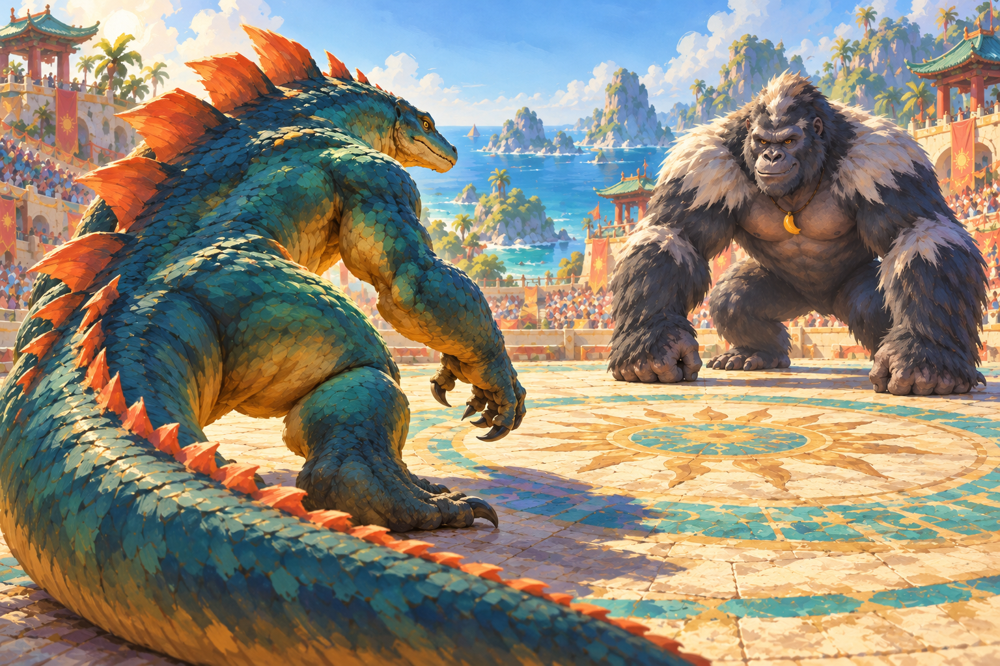
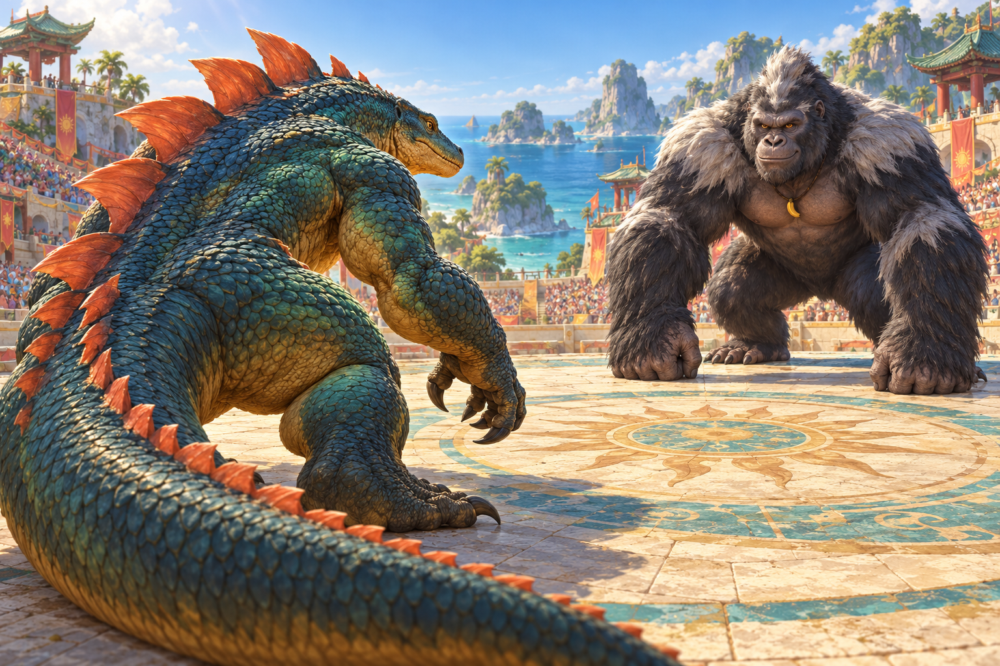

# Visual-direction review: three looks, four production pipelines

> **Production update:** The user accepted the pose-based trial and approved the complete six-kaiju game. The former stop/gate recommendations below are historical and superseded by the [v1.0 production brief](../release/PRODUCTION-BRIEF.md) and [release review](../release/REVIEW.md). Continuous rigging is not required.

**Approval update:** the user approved sample 03 as the visual target for the bounded [animation feasibility trial](../animation-trial/REPORT.md). That trial is now delivered with partial results, not a production pass. No complete playable battle or full production is approved. The original POC remains in version control as a technical experiment whose artwork failed acceptance.

The [updated GDD v1.1](../GDD-v1.1.md) permits illustrated 2D, layered 2.5D, pre-rendered 3D, real-time 3D, and hybrids. Gameplay, stats, simultaneous combat, the three-second mash, Guard & Counter, and bilingual requirements are unchanged.

Read [the four-pipeline comparison and recommendation](PIPELINE-COMPARISON.md) and [the next proposed POC and acceptance gates](NEXT-POC.md). The recommendation is **the more expressive graphic character treatment in sample 03, produced as illustrated characters in a matching layered painted arena, with restrained real-time compositing and effects**. Approve the visible direction and a realistic way of producing animated assets before implementation.

## What these images prove

All samples are **generated 2D art targets**. They are not new game screenshots, actual Blender renders, rigged models, layered character files, animation footage, or mobile-performance evidence. In particular, a render-like image does not prove that the depicted 3D model exists.

Each sample shows rear-facing Komodor in the lower foreground, front-facing Grumbongo farther away, a shared arena world, and an intended treatment of anatomy, detail, shading, and light. Generated samples are deliberately shown without fake UI; the future HP bars, controls, and EN / 繁中 text would remain working localized interface elements.

**Three looks do not imply three working pipelines.** Pipelines B (rendered sprites) and C (real-time 3D) could use the same approved sculpted image treatment. Pipeline D can use painted characters with entirely 2D staging. A single frame cannot tell those implementations apart.

## 01 — Painted illustration

This version uses brush-shaped fur and scales, warmer reflected light, and a softer painted environment. It directs detail toward the character forms instead of rendering every strand and pore. The rear silhouette, tail mass, opposing silver mantle, and shared light provide a stronger visual foundation than the first POC. It is a viable painterly alternative to the recommended graphic treatment in 03.

What still needs work: fine surface detail remains dense, the foreground tail takes substantial screen area, and Grumbongo's face could carry more distinctive humor. This is not a clean layered source file; no hidden body surfaces, rig, pose set, or repeatable action export has been demonstrated. The next trial must show that this image quality survives motion rather than becoming a painted puppet.

**Potential production routes:** A, or the recommended illustration-led D. Material and lighting are primarily baked/painted; arbitrary camera orbits and arbitrary relighting are not implied.

## 02 — Sculpted / rendered appearance

This treatment emphasizes dense scales, individually described fur, volume, contact shadows, and detailed sunlight. It is useful as a source-asset quality benchmark for pipelines B or C. It also shows why a better renderer alone would not fix the initial POC: the anatomy, surface grouping, and facial construction would need to exist in the assets first.

What still needs work: the realistic fur/scale density pushes toward naturalistic fantasy art rather than the intended expressive stylization. Grumbongo remains close to a literal silverback; a stronger original facial/silhouette design would help. Warm, friendly sporting personality should not depend only on a small charm. **No model or animation was created to produce this image.**

**Potential production routes:** B or C, if high-quality original models, rigs, textures, and authored clips can actually be supplied. The available image generator does not supply those assets. Blender is installed, but that does not solve their production.

## 03 — Graphic animation treatment

This alternative tests stronger shape design and a more explicitly drawn animation treatment instead of competing on detailed material rendering. It is a separate artistic candidate; its final character proportions and markings must be reviewed rather than assumed interchangeable with the other samples.

**My recommended starting candidate.** Grumbongo's raised brow, asymmetric grin, larger designed silver crest, and ready fist communicate personality more directly than the naturalistic treatment in 02. Komodor's alert eye, broad shoulder planes, poised claw, and weighted tail give the rear view a readable attitude. The graphic shadows and broader fur masses suit the GDD's vibrant, slightly cartoonish sporting world. This recommendation favors designed expression over finer surface rendering; it is not a claim that animation is solved.

What still needs work: Grumbongo's apparent scale/proportions differ from 01/02, the charm and markings are not identical, and neither fighter has a verified turnaround. Surface detail remains dense at phone size. The close composition needs a dedicated HUD/portrait crop review. The specific pose, fingers, scutes, and hidden surfaces must be locked and cleaned before this can become an animation master.

**Potential production routes:** A or D, with authored pose replacements and layered motion. This is a single illustrated frame, not a demonstrated cel-animation sequence. Changing an illustration style does not remove the work of preparing actual motion assets.

## Limits shared by the samples

- Fixed views and single poses hide the hard questions of anatomy consistency, deformation, contact, occlusion, and transitions. Similar identity in three images is not proof of a six-kaiju production process.
- Scute shapes, fur clusters, finger/toe construction, and face details can drift between generations. Do not treat these as exact turnarounds or alternate frames of one animation. A character bible and supervised source-asset preparation are still needed.
- A full landscape image is not a tested phone crop. The tail/forearms and tall scutes compete with HUD space. Review portrait/landscape compositions with actual localized controls in the next approved POC.
- A painted light source looks coherent in one frame but may be difficult to preserve while limbs rotate. Contact shadows and major foreshortening require deliberate animation art, not just runtime movement.
- The images have no sound or interactive timing. A visually rich still cannot prove immersion, satisfying impact, or responsive input.
- The current environment can generate/review stills and implement engineering. A dependable high-quality layered-art/animation workflow remains unproven; specialist art preparation/cleanup is the realistic baseline for production planning.

See [source prompts and provenance](ART-PROVENANCE.md) for how the images were created, and [review-package checks](REVIEW-CHECKS.md) for what was verified and what remains unproven. All three are original generated proposals, not extracts from the supplied commercial-game references.

## Review checkpoint

Sample 03's target was approved; the immediate checkpoint is now review of the [actual animated-asset trial and its limitations](../animation-trial/REPORT.md). The static target remains unchanged. Its approval does not imply acceptance of the animation result or a reliable full-roster asset workflow. Full production remains deferred.
